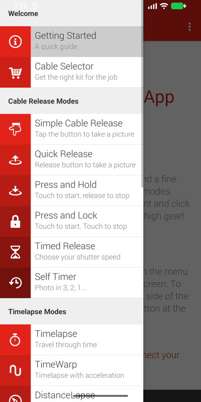
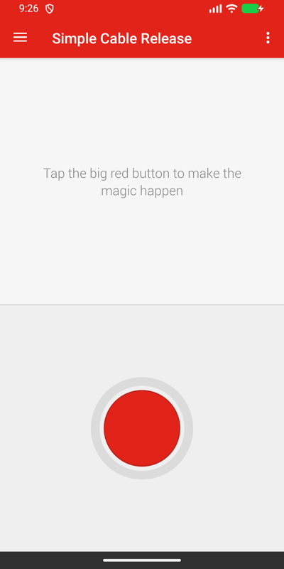
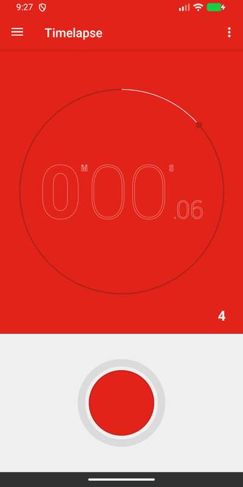
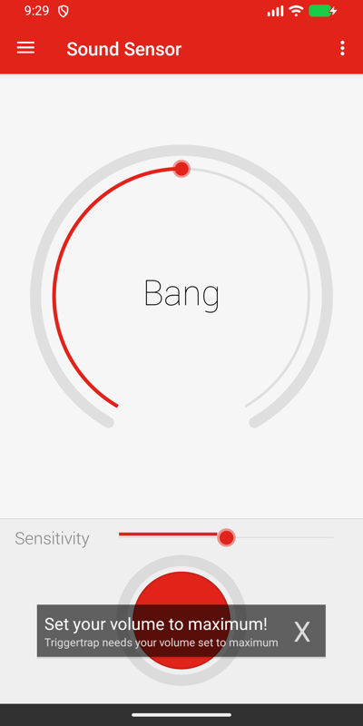
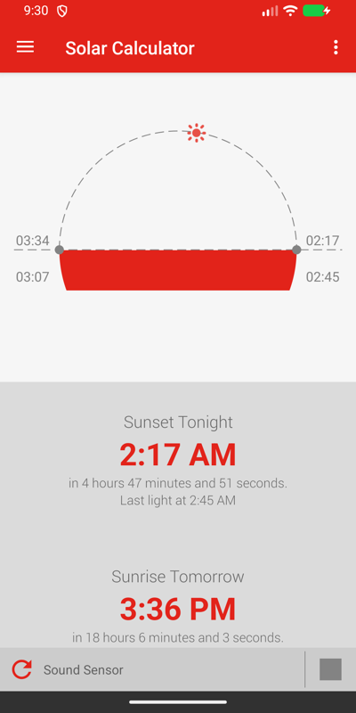
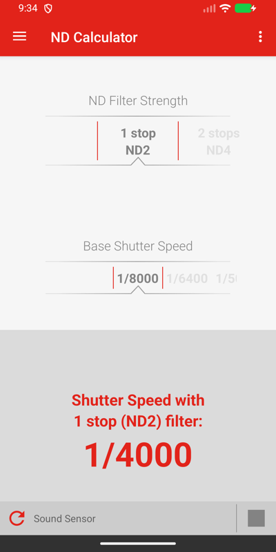

# Triggertrap for Android

Turn your phone into a wired camera remote again. Triggertrap Mobile was a small dongle that
plugs into the headphone jack and converts an audio pulse into a shutter press on a camera
cable. The company went out of business in 2017 and the app disappeared from the Play Store;
the hardware still works. This is the original Android app, kept alive and updated to run on
current Android versions (8.0 up to 16).

> This is a community continuation of the open-sourced Triggertrap app, not a product of
> Triggertrap Ltd, which no longer exists. The licence of the original code is kept as is
> (see [LICENSE](LICENSE)).

**Works with:** a Triggertrap Mobile dongle (MD3 / MD3b or earlier) or any compatible
audio-jack trigger, plus the camera cable for your camera. Developed and tested against a
Samsung NX1000; the app contains the Samsung NX timing tweak of the original.

## Modes

| Group | Modes |
|---|---|
| Cable release | Simple cable release, quick release, press and hold (bulb), press and lock, timed release, self timer |
| Timelapse | Timelapse, TimeWarp (eased interval), distance lapse (GPS), star trail, bramping (bulb ramping) |
| Sound | Sound sensor (clap, whistle, tap) |
| HDR | Long-exposure HDR, HDR timelapse |
| Remote | Wi-Fi slave / master: one phone triggers others on the same network |
| Calculators | Sunrise / sunset with civil twilight, ND filter |

Every mode keeps running when you switch screens or leave the app: a notification shows what
is running and has a Stop button.

## Getting started

1. Install the APK from the [releases page](https://github.com/PhilippMundhenk/triggertrap-android/releases)
   (allow installs from unknown sources when asked).
2. Plug the dongle into the headphone jack (or a USB-C to 3.5 mm adapter), the camera cable
   into the dongle and the camera. Set the camera to manual focus, or half-press focus first.
3. Turn the media volume all the way up. The app warns when it is not at maximum: the dongle
   needs the full signal.
4. Open the menu (swipe from the left or tap the menu icon), pick a mode, tap the big red
   button.
5. The first time a mode needs it, Android asks for the microphone (sound sensor), the
   location (distance lapse, solar calculator) or notifications (running modes).

Which cable: *Menu, Cable Selector* shows the cable code for your camera.

## Screenshots

| Modes menu | Cable release | Timelapse |
|---|---|---|
|  |  |  |

| Sound sensor | Solar calculator | ND calculator |
|---|---|---|
|  |  |  |

## Documentation

* [docs/APP.md](docs/APP.md) — every mode, the settings, the dongle and cables, troubleshooting
* [docs/DEVELOPMENT.md](docs/DEVELOPMENT.md) — building, tests and coverage, CI, releases, known gaps
* [docs/DESIGN.md](docs/DESIGN.md) — how the app works and what was changed in 2026, [docs/adr/](docs/adr/) — decisions
* [docs/BRANDING.md](docs/BRANDING.md) — the look (kept from the original)

Status: 4.0.0 runs on Android 8 to 16 and is verified on an emulator; the first run with a
real dongle and camera is [issue #8](https://github.com/PhilippMundhenk/triggertrap-android/issues/8).
Questions and problems: [GitHub issues](https://github.com/PhilippMundhenk/triggertrap-android/issues).

## Credits

The original app was built by Triggertrap Ltd (Android by Neil Davies, Scott Mellors and
others; iOS by Matt Kane, Ross Gibson and Valentin Kalchev) and released as open source by
Haje Jan Kamps in 2017.
